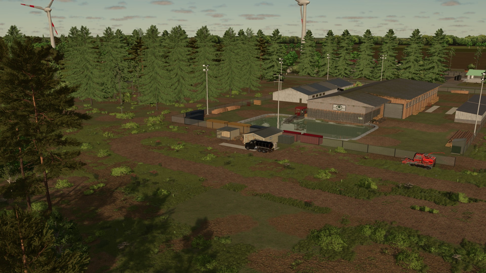
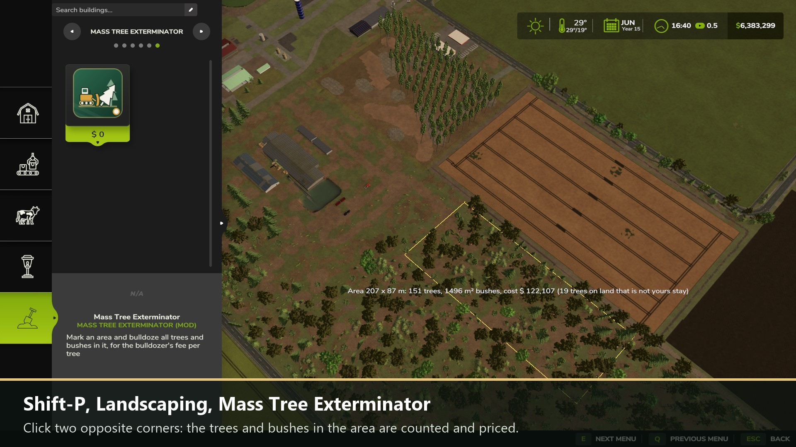
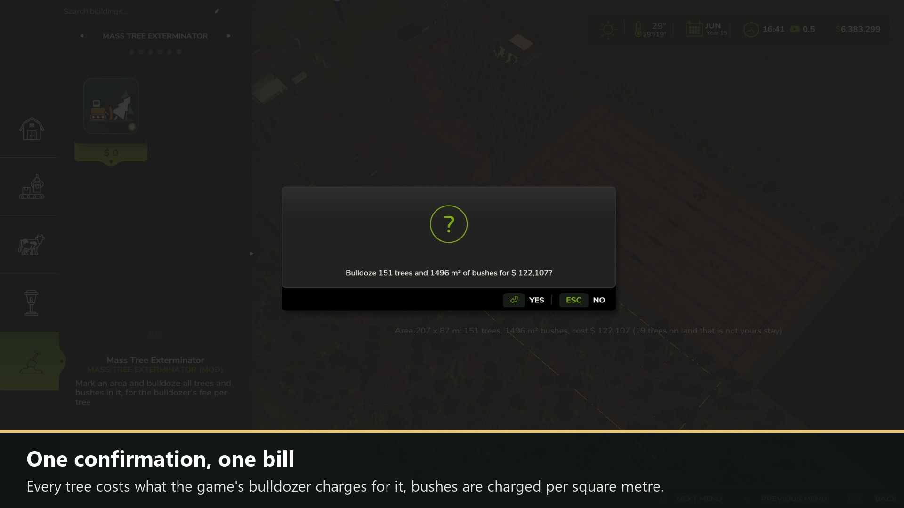
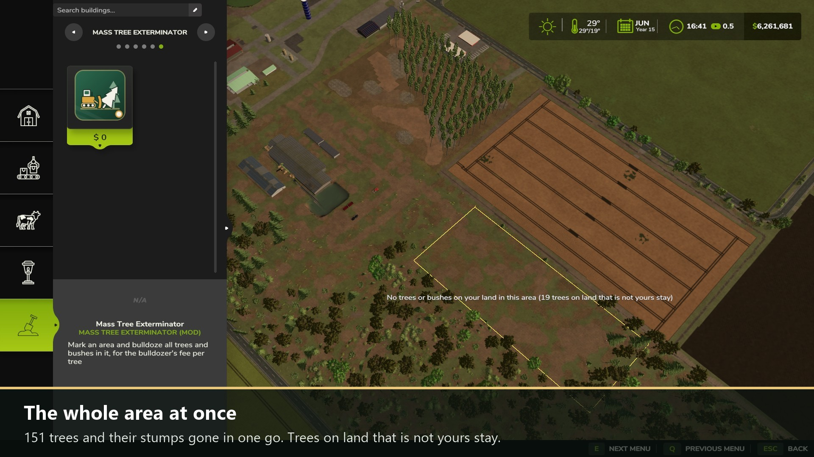

<p align="center">
  <a href="https://github.com/DTM-Mods"></a>
</p>

<p align="center">
  
</p>

<h1 align="center">Mass Tree Exterminator</h1>

<p align="center">
  
  
  
  <a href="https://github.com/DTM-Mods"></a>
</p>

<p align="center">
  <b>Mark an area in the construction menu and bulldoze every tree and bush in it at once, for the bulldozer's own fee per tree.</b>
</p>

<p align="center">
  
</p>

Since patch 1.25.1.0 the construction menu's bulldozer (demolition mode) removes standing trees for a fee, one click
per tree. Clearing a wood lot for a new field or yard is hundreds of clicks. Mass Tree Exterminator does a whole area:

- **Trees:** every standing tree in the area goes, stump and all, and each one costs exactly what the bulldozer
  shows for that tree.
- **Bushes:** the bushes painted on the map (the construction menu's plant brush) are cleared too, at the
  construction menu's landscaping rate per m². `mteBushes` switches this off.
- **Your land only:** trees and bushes on other farms' land, or land that cannot be bought, stay.
- **One confirmation, one bill:** the cursor shows the number of trees, the m² of bushes and the total cost before you
  confirm.

<p align="center">
  
</p>

**Construction menu** (Shift + P > Landscaping > Mass Tree Exterminator)

1. Left click one corner of the area, then the opposite corner. The area is drawn on the ground, the trees that will
   go get a red marker, trees on other land a grey one.
2. Left click again: "Bulldoze area ($...)". Confirm, and everything goes. The result shows next to the cursor.

| Input | Action |
|---|---|
| Left click | First corner, opposite corner, then bulldoze the area (with a confirmation) |
| Right click | Remove the last corner |
| Esc | Clear the area |

<p align="center">
  
</p>

| Command | What it does |
|---|---|
| `mteBushes` | Bushes on/off (off: only trees are removed) |
| `mteInfo` | Write where the tree fee comes from, the bulldozer's functions and the bush layers to log.txt |
| `mteTrace` | On/off: log every call of the game's bulldozer, every event and money change. Remove one tree by hand with the bulldozer while it is on |
| `mteDebug` | Debug logging on/off |

<p align="center">
  
</p>

The server does the work: the client sends the area, the server checks the landscaping permission, the land and the
farm's money, removes the trees (a batch per frame) and bushes, charges the farm once and answers that player only.
The farm is taken from the player's connection, not from what the client claims.

<!-- dtm-screenshots -->

<p align="center">
  
</p>

<p align="center">
  
  
</p>

<p align="center">
  
  
</p>

<!-- /dtm-screenshots -->

<p align="center">
  
</p>

Put `FS25_MassTreeExterminator.zip` in `Documents/My Games/FarmingSimulator2025/mods`. In multiplayer, install it on
the server and on every player's game. Needs game version 1.25.1.0 or later.

<p align="center">
  
</p>

- The tree fee is read from the game's bulldozer while the mod runs. If a game update changes how the bulldozer shows
  it, the cursor says "tree fee estimated" and the mod charges 250 per tree: run `mteInfo`, then `mteTrace`, remove
  one tree by hand with the bulldozer, run `mteTrace` again and send log.txt.
- Like the bulldozer, only standing trees are removed: stumps and logs of trees felled earlier stay. Saplings that have
  no wood yet are not removed.
- Tested in single player. In multiplayer the server does the removal the same way, which still needs confirming on a
  dedicated server.
- At most 1000 m per side per area.

<p align="center">
  
</p>

How it works:

- **Finding trees:** `overlapBox` over the area with `CollisionFlag.TREE`, keeping static split shapes with a split
  type that were never cut (the test of the game's `gsTreeCut` command), whose trunk stands in the area.
- **Removing trees:** on the server, `deleteSplitShape(shape)` like the 1.25 stump cutter does. A map tree is a LOD
  group (`LOD0` split shape, `LOD1` far model); a plain `delete` of `LOD0` leaves `LOD1` standing, `deleteSplitShape`
  removes the tree. Then `g_treePlantManager:removingSplitShape`, and the collision map and AI areas are marked dirty.
- **Stumps:** removing a whole tree leaves a stump. The server records the wood around every tree of the job before
  any of them goes, and afterwards (right away and a second later) removes the new wood at each removed tree's base,
  for free. Neighbouring trees and older stumps are never touched.
- **The fee:** since 1.25.1.0 `ConstructionBrushDestruct:visualizeTreeMouseOver(tree)` prices a tree in a local
  helper and puts the price on its cursor (`cursor:setMessage("$ 1,818")`). The mod hovers each tree on a
  never-activated bulldozer with its own cursor, reads the amount from that message and hovers nothing again so the
  highlight is reset. Older ways (a fee getter or constant) are still looked for; the last resort is 250 per tree.
- **Bushes:** a `DensityMapModifier` on each `deco...Bush...` foliage layer, in strips of the area that are the farm's
  own land (2 m resolution), at `Landscaping.PAINT_BASE_COST_PER_M2` per m².
- **Multiplayer:** `MassTreeExterminatorRemoveEvent` (client to server) and `MassTreeExterminatorResultEvent`
  (server to the requesting client).

The icon is drawn by `_brand/tools/make_icons.py` (glyph `massTreeExterminator`). Tests run offline on Lua 5.1
through Python [lupa](https://pypi.org/project/lupa/), with stubs for the engine:

```
pip install lupa
python tools/test/run_all.py     # every offline test
python tools/check_l10n.py       # English and German texts complete
python tools/build_zip.py        # dist/FS25_MassTreeExterminator.zip + GIANTS packaging checks
```

<p align="center">
  
</p>

### 1.0.0.1

- Screenshots in the README and for the ModHub upload. Nothing changes in the game.

### 1.0.0.0

- First version: area tool in the construction menu (Landscaping), trees for the bulldozer's own fee per tree, the stumps they leave removed too, bushes per m², multiplayer.

<p align="center">
  
</p>

MIT, see [LICENSE](LICENSE). The base-game content the mod works with belongs to GIANTS Software and is not covered by
it.

---

<p align="center">
  <a href="https://github.com/DTM-Mods"></a><br>
  <sub>Part of <a href="https://github.com/DTM-Mods">DTM Mods</a> (Designed To Manage) by PropaineX & Fennell</sub>
</p>
